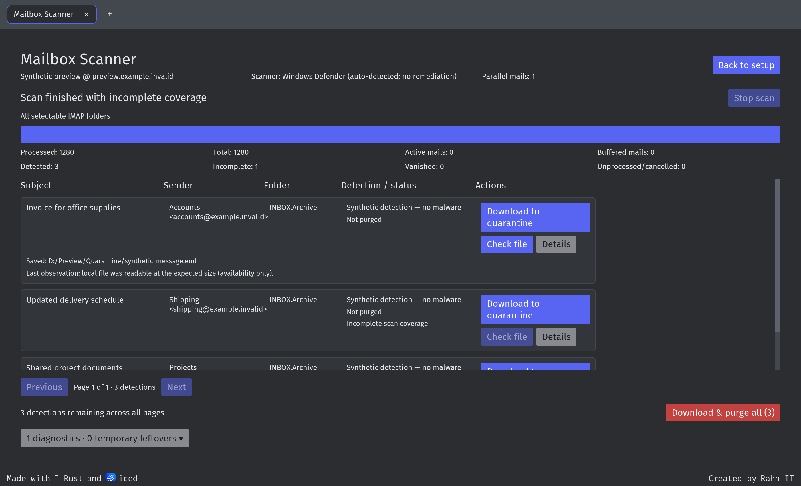
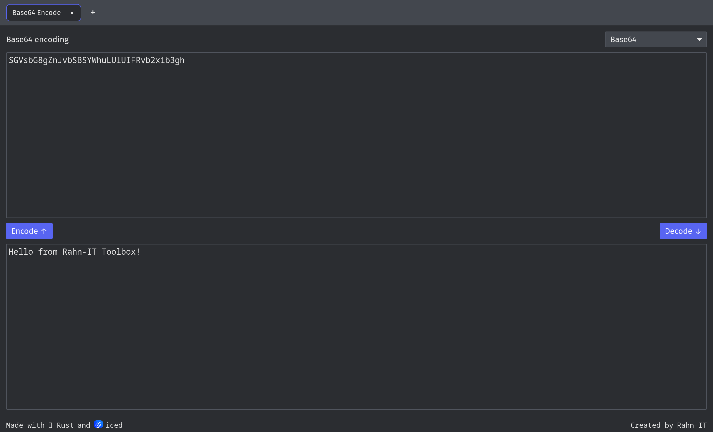
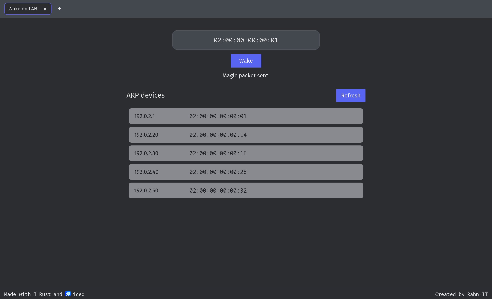
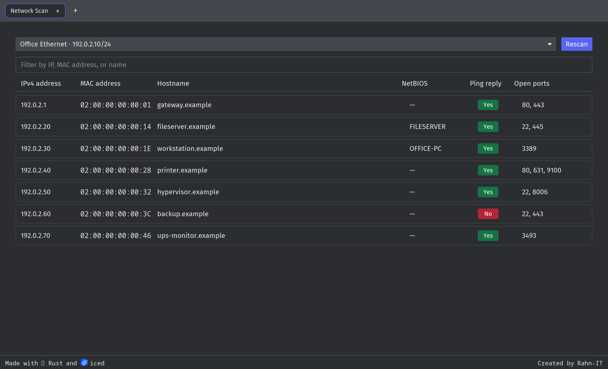

# Rahn-IT toolbox

This is a small collection of useful tools as a simple to download and run executable written in Rust.

## ⚠️WARNING⚠️

> [!WARNING]
> **This repository is heavily vibe coded.**
>
> These are mostly internal tools. They are made public for your convinience and inspiration.
>
> These tools were mostly built because we need them. They are not as polish as a public app probably should be.
> Nevertheless, they might be useful to you, so I'm keeping this public. 
>
> Feel free to check out the code if you're unsure

# tools

## Mailbox scanner

This simple tool connects to an IMAP mailbox, downloads all mails as `.eml` files temporarily and lets either Avast or Windows Defender check them. Infected mails can be downloaded into a local quarantine folder and purged from the mail server.

## quick install (windows only)

The quick install is basically the same as ninite or other quick install tools.
It just downloads the installers and runs them for you. It will still ask for admin rights if needed though.
This is just a small list of applications I need from time to time. PRs are welcome though.

## Quick tools (Windows only)

Some simpler helpers for some configurations I commonly need

- Run AdwCleaner
- Clear Browser Default Extensions and Policies for Chrome, Firefox, and Edge
- Disable Hibernation
- Set Power Config
- Delete Old Temporary Files

## Encode / Decoder

The encoder and decoder supports the following formats:

- Eml & SMTP quoted-printable
- Base64
- Unicode codepoints

## Path Length Checker

This is a simple application to find paths which are over the windows path limit of 260 characters or close to it.

You can Scan a path and then export the found paths into a CSV file.

## Wake on LAN

Enter a MAC address to send a magic packet to wake up a device.
In case you don't know the MAC address it reads the ARP table in the hopes that the MAC is still cached.

## Network Scan

A relatively simple network scan based on just calling `ping` and checking the ARP-Table.

Afterwards, Additional Info is collected for netbios and reverse dns name as well as ports.

Not as sophisticated as nmap, but enough for a rough overview.

## Device Scan

Type in the IP of a device to perform a simple scan on only that device instead of the whole network

## Simple NUT client

I integrated a very simple client which displays the raw numbers from a Network UPS Tools server for debugging.

# Attribution

This project is licensed under the [MIT License](LICENSE).

Developed by [Rahn IT](https://it-rahn.de/).

