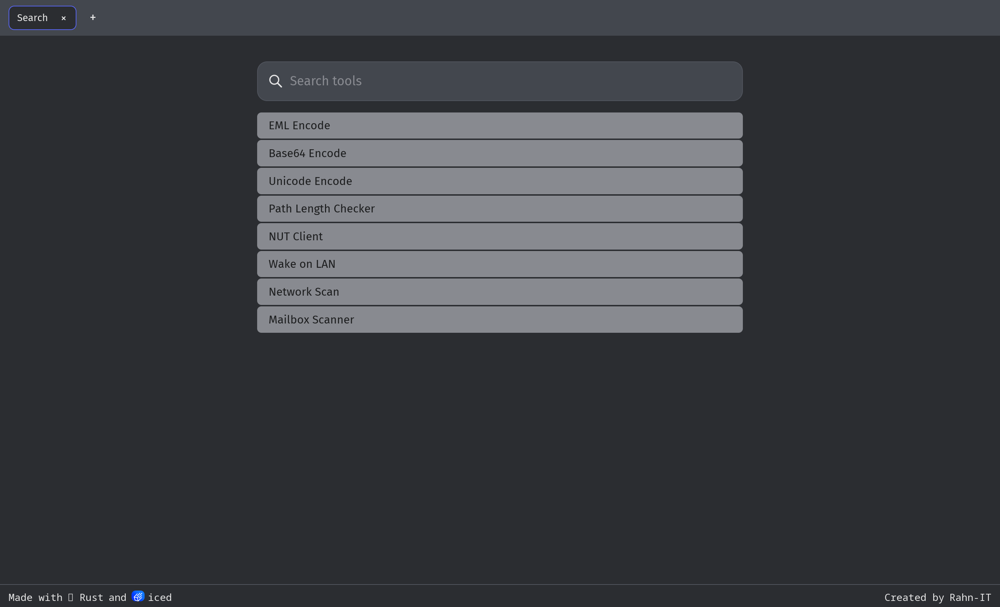
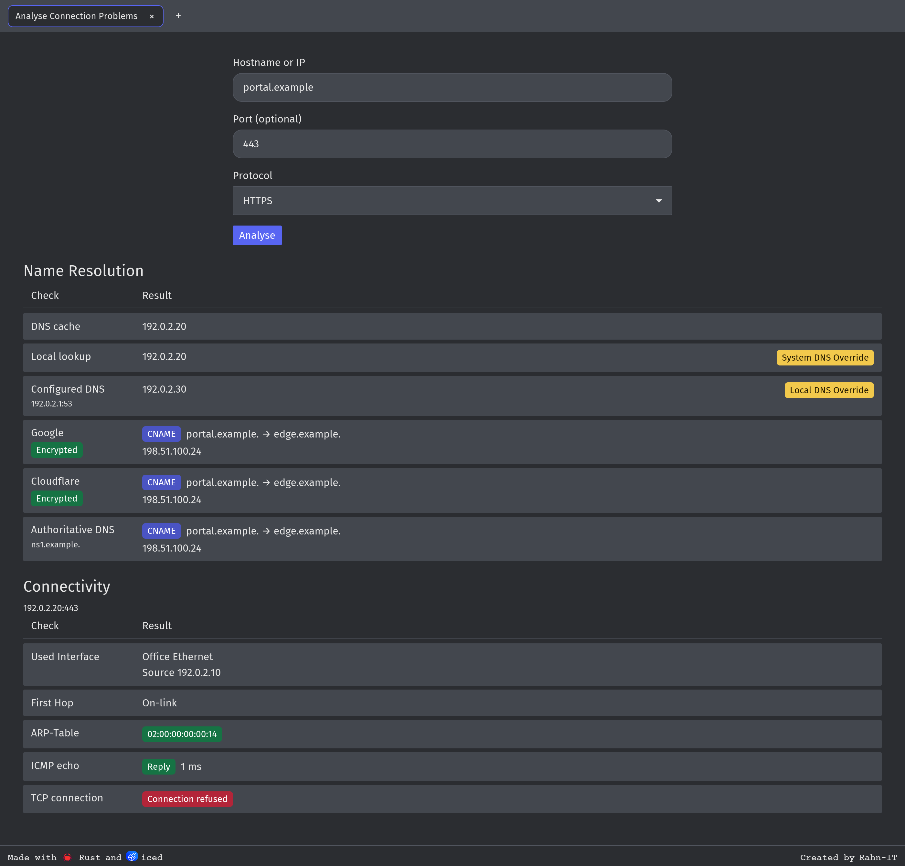
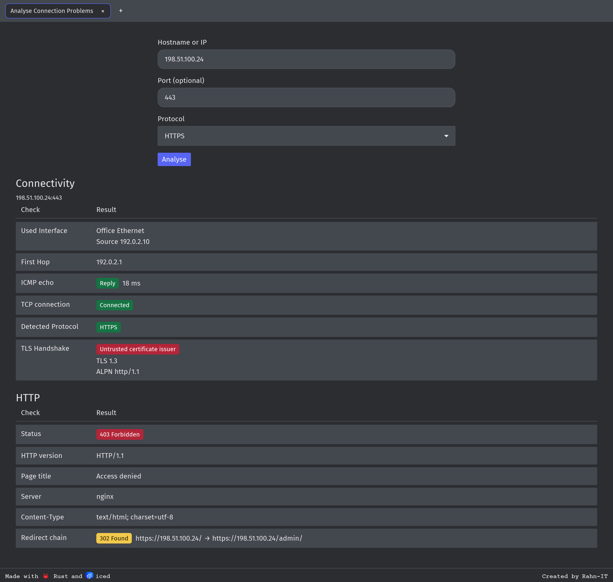
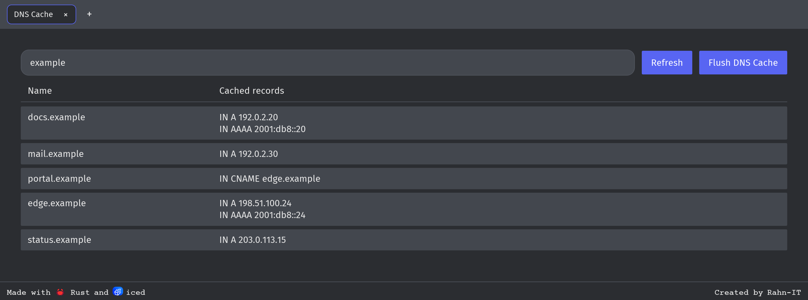
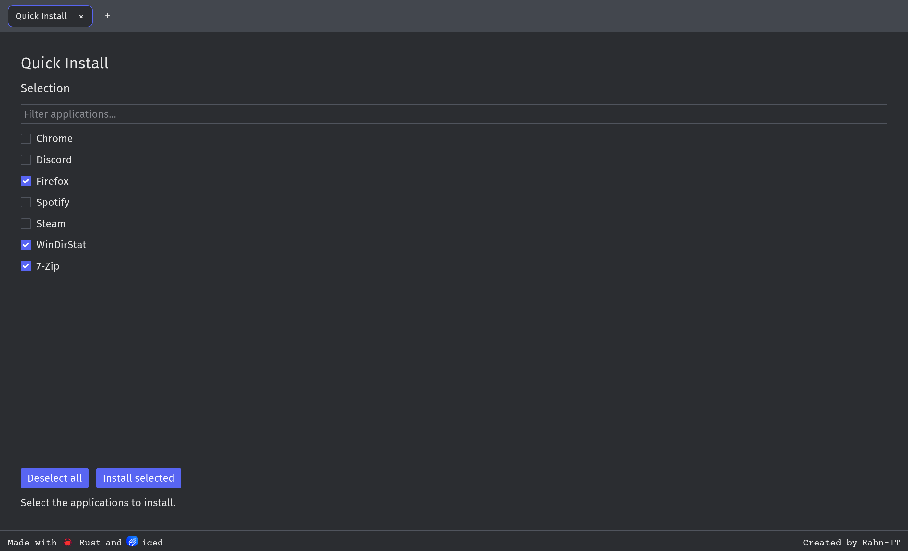
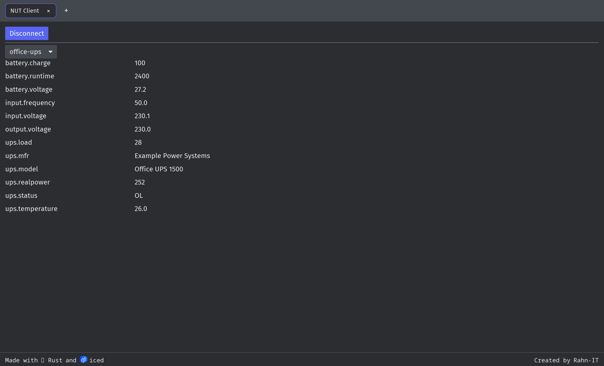

# Rahn-IT Toolbox

This is my personal toolbox written in Rust.

It provides helpers and shortcuts for my daily work and can help with network and OS diagnostics.

## ⚠️WARNING⚠️

> [!WARNING]
> **This repository is heavily vibe-coded.**
>
> These are mostly internal tools. They are made public for your convenience and inspiration.
>
> These tools were mostly built because we need them. They are not as polished as a public app probably should be.
> Nevertheless, they might be useful to you, so I'm keeping this public.
>
> Feel free to check out the code if you're unsure.

# Tools

## Analyse Connection Problems

Enter a hostname or IP address and an optional port to diagnose a connection. The tool shows name resolution, routing, ARP, and any applicable TCP, TLS, and HTTP results.

## DNS Cache

Search and refresh cached DNS records, or flush the cache where supported.

## Mailbox Scanner

This tool connects to an IMAP mailbox, temporarily downloads messages as `.eml` files, and scans them with Avast or Windows Defender. Infected messages can be saved to a local quarantine folder and purged from the mail server.

## Quick Install (Windows only)

Like Ninite, Quick Install downloads and runs installers for the applications you select. It asks for administrator rights when needed.
It covers a small list of applications I use from time to time. Pull requests are welcome.

## Quick Tools (Windows only)

These tools handle common Windows maintenance tasks.

- Run AdwCleaner
- Clear Browser Default Extensions and Policies for Chrome, Firefox, and Edge
- Disable Hibernation
- Set Power Plan Timeouts
- Delete Old Temporary Files

## Encoder / Decoder

The encoder and decoder support the following formats:

- Quoted-printable text for EML and SMTP
- Base64
- Unicode code points

## Path Length Checker

Find paths that approach or exceed the 260-character Windows path limit.

You can scan a directory and export the results to CSV.

## Wake on LAN

Enter a MAC address to send a magic packet to wake up a device.
If you don't know the MAC address, the tool can look for it in the ARP cache.

## Network Scan

A simple network scan that uses `ping` and the ARP table.

The scan also checks for NetBIOS names, reverse DNS names, and open ports.

It provides a quick overview of devices on the network.

## Device Scan

Enter an IP address to scan a single device.

## NUT Client

This client displays raw values from a Network UPS Tools server for debugging.

# Attribution

This project is licensed under the [MIT License](LICENSE).

Developed by [Rahn IT](https://it-rahn.de/).

